<div align="center">

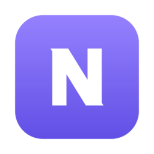

# Nora

### Tu espacio. Tus reglas.

Salas colaborativas **temporales** para trabajar en equipo: archivos, pizarra, documentos, chat, tareas,<br/>
**llamadas y videollamadas** y asistencia remota. Todo en tu propio servidor, con un solo comando.

<p>
  <a href="https://github.com/Tecsharp/Nora/actions/workflows/ci.yml"></a>
  <!-- ── Insignias de calidad: se activan cuando exista el análisis (ver docs/CALIDAD.md, «Las insignias») ──
  SonarQube propio: en tu proyecto → «Project Information» → «Get project badges» → copia las URL (incluyen un token).
  SonarCloud (repositorio público): cambia KEY por tu clave de proyecto.
  <a href="https://sonarcloud.io/summary/new_code?id=KEY"></a>
  <a href="https://sonarcloud.io/summary/new_code?id=KEY"></a>
  <a href="https://sonarcloud.io/summary/new_code?id=KEY"></a>
  Coverity Scan (cuando registres el proyecto): cambia PROJECT_ID.
  <a href="https://scan.coverity.com/projects/PROJECT_ID"></a>
  -->
  <a href="LICENSE"></a>
</p>

<p>
  
  
  
  
  
  
  
  
</p>

[**Arranque rápido**](#-arranque-rápido) &nbsp;·&nbsp; [**Funciones**](#-qué-incluye) &nbsp;·&nbsp; [**Capturas**](#-capturas) &nbsp;·&nbsp; [**Arquitectura**](#-arquitectura) &nbsp;·&nbsp; [**Documentación**](#-documentación)

<br/>

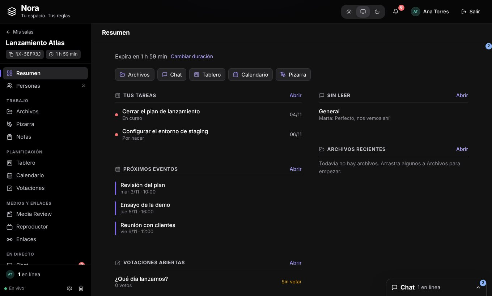

</div>

<br/>

## ✨ Qué incluye

<table>
<tr>
<td width="50%" valign="top">

### 🗂️ Trabajo
- **Archivos** con carpetas, subida reanudable por trozos, visor de imágenes/PDF/texto y edición colaborativa de **documentos, hojas y presentaciones**.
- **Pizarra** infinita con Excalidraw en tiempo real.
- **Notas** y portapapeles compartido.

### 📅 Planificación
- **Tablero** de tareas con arrastrar y soltar.
- **Votaciones** anónimas con cierre automático.
- **Calendario** con mes, semana y día, **invitaciones**, **llamada en la cita** y vista de **disponibilidad** de cada persona (sus eventos personales solo salen como «Ocupado»).

</td>
<td width="50%" valign="top">

### 📞 Llamadas y videollamadas
- Código de llamada, sala de espera con **admisión del anfitrión**.
- **Mosaico, destacado y barra lateral**, pantalla compartida, reacciones, mano levantada, subtítulos y **modo complementario**.
- Chat de la llamada que **queda en Mensajes**.

### 💬 Comunicación
- **Chat** con grupos, mensajes directos y búsqueda en historiales enormes, siempre a mano en la barra lateral.
- **Notificaciones** con enlace al lugar exacto.
- **Foco** (Pomodoro compartido) y **Reproductor** sincronizado.

</td>
</tr>
<tr>
<td valign="top">

### 🖥️ Asistencia remota
Ver (y, con permiso, **controlar**) la pantalla de otra persona. Un **agente nativo** para Windows, macOS y Linux, con tema claro/oscuro.

</td>
<td valign="top">

### 🔐 Pensado para ser privado
Salas que **se borran solas** al expirar (o se conservan si tú quieres), roles por sala, contenedores endurecidos y archivos sin enlaces directos.

</td>
</tr>
</table>

> **IA opcional** con DeepSeek: resumir el chat, redactar, crear tareas o eventos desde un texto. Viene apagada y sin rastro en la interfaz hasta que la actives en el `.env`.

## 📸 Capturas

<table>
<tr>
<td width="50%">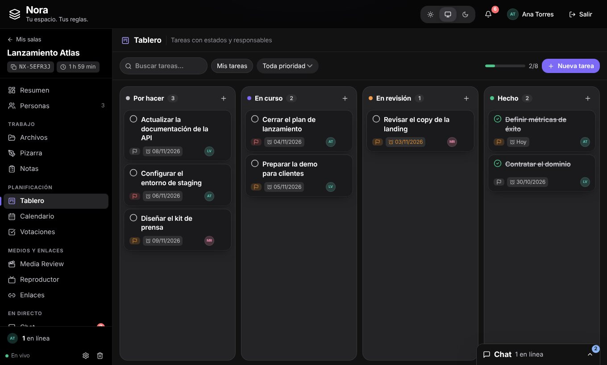<br/><sub><b>Tablero</b> · tareas con estado, prioridad y responsable</sub></td>
<td width="50%">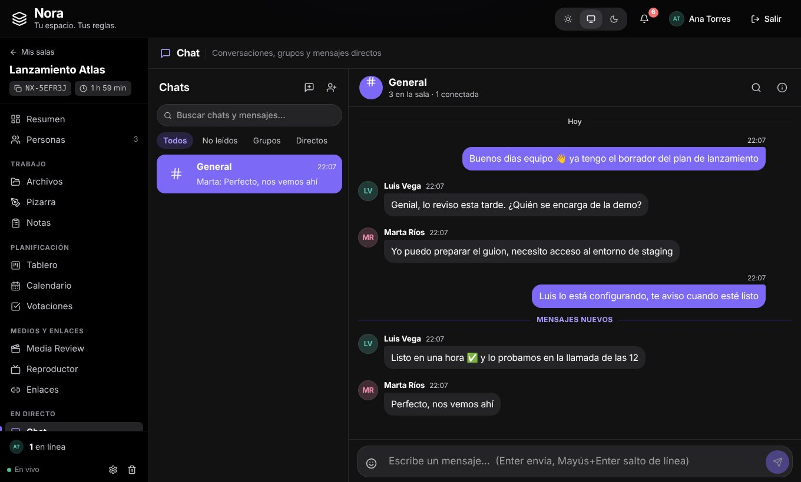<br/><sub><b>Chat</b> · general, grupos y mensajes directos</sub></td>
</tr>
<tr>
<td>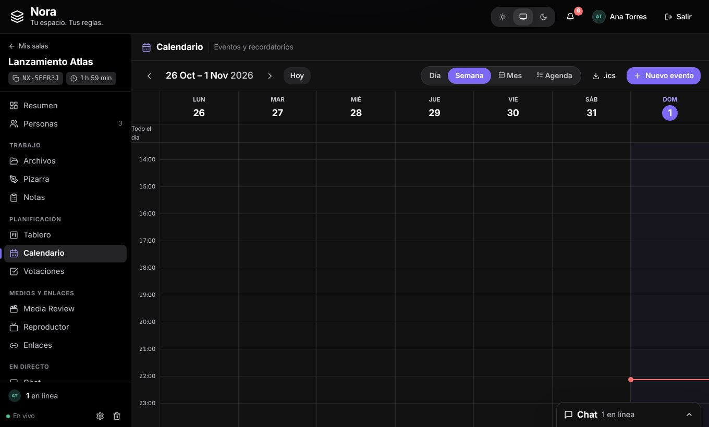<br/><sub><b>Calendario</b> · eventos y recordatorios</sub></td>
<td>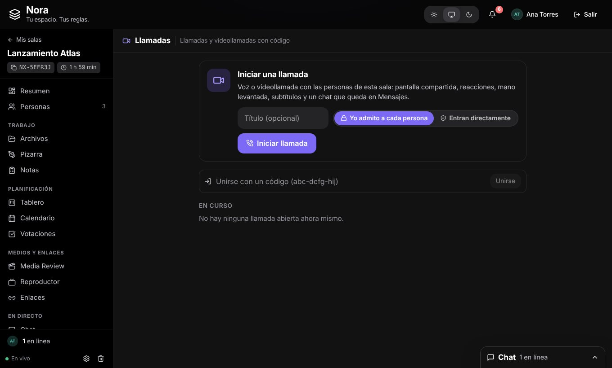<br/><sub><b>Llamadas</b> · iniciar, unirse con código y ver las últimas</sub></td>
</tr>
<tr>
<td>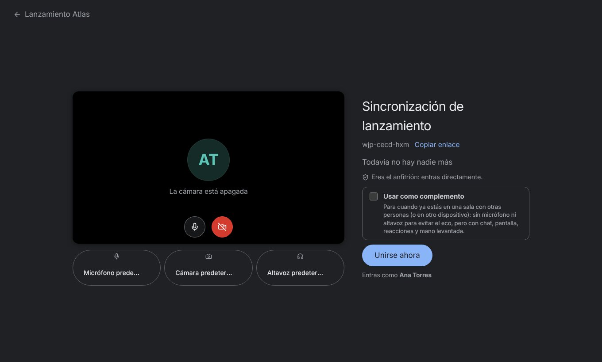<br/><sub><b>Antes de entrar</b> · cámara, micrófono y modo complementario</sub></td>
<td>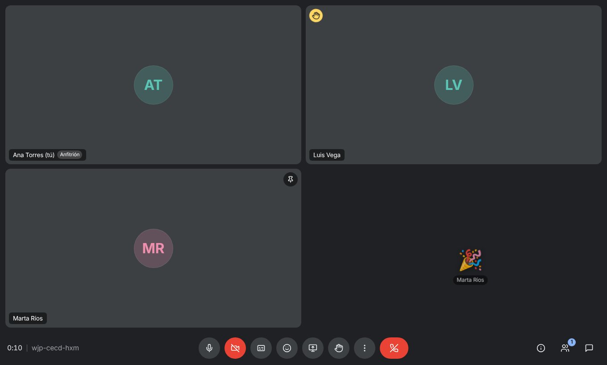<br/><sub><b>En la llamada</b> · mosaico, reacciones y mano levantada</sub></td>
</tr>
<tr>
<td>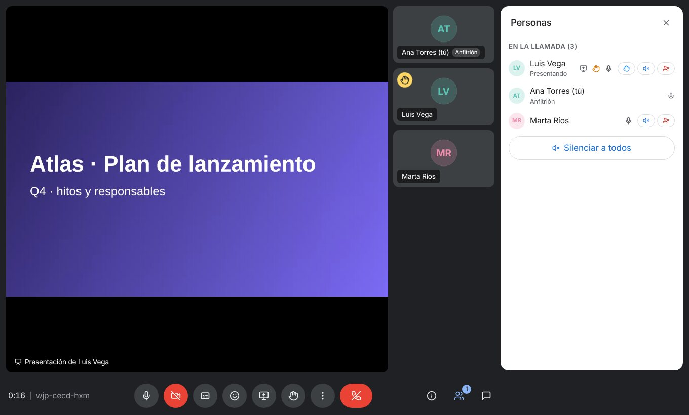<br/><sub><b>Presentar pantalla</b> · la presentación arriba y las personas a un lado</sub></td>
<td>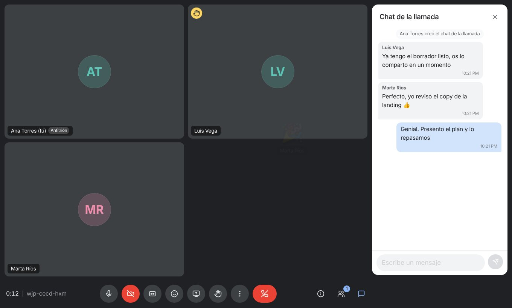<br/><sub><b>Chat de la llamada</b> · queda como grupo en Mensajes</sub></td>
</tr>
</table>

## 🚀 Arranque rápido

Necesitas **Docker con Compose v2**. Nada más.

```bash
git clone https://github.com/Tecsharp/Nora.git && cd Nora
./setup.sh          # en Windows: ./setup.ps1
```

El script crea el `.env` con secretos aleatorios, completa las variables que falten y lanza `docker compose up -d --build`. Al terminar abre **<http://localhost:29817>** (la contraseña del administrador inicial se muestra por pantalla).

<details>
<summary><b>Hacerlo a mano</b></summary>

```bash
cp .env.example .env     # cambia los secretos «cambia-esto»
docker compose up -d --build
```
</details>

<details>
<summary><b>Actualizar a una versión nueva</b></summary>

```bash
git pull
./setup.sh               # agrega al .env las variables nuevas y reconstruye
```
Las migraciones de la base de datos (Flyway) se aplican solas al arrancar.
</details>

> 🎥 **Cámara y micrófono** solo funcionan en **HTTPS** o `localhost`. Para usar Nora con llamadas desde otros equipos, ponla detrás de HTTPS (por ejemplo con un túnel de Cloudflare) y define `NORA_COOKIE_SECURE=true`.

## 🧱 Arquitectura

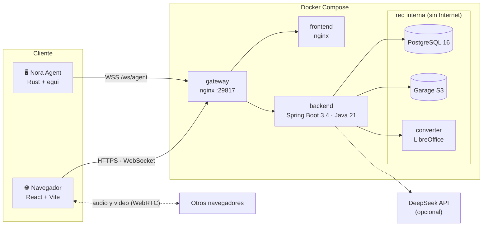

| Servicio | Tecnología | Notas |
|---|---|---|
| `gateway` | nginx | Único puerto publicado. Límites por IP, cabeceras de seguridad y CSP, proxy de `/api`, `/ws` y `/ws/agent`. |
| `frontend` | React 18 + Vite + TypeScript | SPA estática. |
| `backend` | Spring Boot 3.4 / Java 21 | JWT, Flyway, WebSocket, señalización de llamadas. Configura Garage él solo. |
| `db` | PostgreSQL 16 | Solo en la red interna. |
| `garage` | [Garage](https://garagehq.deuxfleurs.fr/) (S3) | Archivos de las salas; bucket privado y sin puertos publicados. |
| `converter` | LibreOffice headless | Procesa archivos de personas usuarias en un contenedor aislado, de solo lectura y sin Internet. |
| `agent` | Rust + egui | Programa de escritorio para controlar el equipo, fuera de Docker. |

## 📞 Llamadas en un vistazo

1. En una sala, abre **Llamadas → Iniciar llamada** y elige si admites tú a cada persona o si entran directamente.
2. Comparte el **código** (`abc-defg-hij`) o el enlace: solo entran personas de la sala.
3. Dentro: **Mosaico / Destacado / Barra lateral**, presentar pantalla, reacciones, mano levantada, subtítulos y **Chat de la llamada**, que queda como grupo en *Mensajes*.

El audio y el video van **directos entre navegadores** (WebRTC en malla): Nora solo señaliza y nunca ve el contenido. Por eso el límite por defecto son **8 personas** (`NORA_CALL_MAX_PARTICIPANTS`). Detalles, subtítulos, límites y protocolo en [docs/LLAMADAS.md](docs/LLAMADAS.md).

## 🖥️ Agente de escritorio

Un navegador no puede mover el mouse de otra computadora, así que la asistencia con control usa un **programa pequeño** para **Windows, macOS y Linux**: se vincula con tu cuenta con un código de un solo uso, sigue el tema claro u oscuro del sistema, muestra qué usuario está conectado y su versión, y **solo aplica clics y teclas mientras tú lo permites**.

Se descarga desde la propia herramienta *Asistencia* (releases de GitHub) o se compila con `agent/build.sh` · `agent/build.ps1`. Más en [agent/README.md](agent/README.md).

## ⚙️ Configuración

Todo se controla desde el `.env` (el `setup.sh` lo crea y lo mantiene al día). Lo más habitual:

| Variable | Para qué | Por defecto |
|---|---|---|
| `NORA_PORT` / `NORA_BIND` | Puerto y dirección donde escucha (`127.0.0.1` = solo esta máquina) | `29817` / `0.0.0.0` |
| `NORA_ALLOW_REGISTRATION` | Permitir que cualquiera se registre | `true` |
| `NORA_AUTH_MODE` | Cómo se entra: `password`, `google` o `both` (el administrador lo cambia también en Admin → Sistema y manda sobre esta variable) | `password` |
| `NORA_GOOGLE_CLIENT_ID` · `NORA_GOOGLE_CLIENT_SECRET` | Credenciales OAuth de Google; sin ellas solo hay correo y contraseña | vacío |
| `NORA_PUBLIC_URL` | Dirección pública (p. ej. `https://nora.tudominio.com`) para la redirección de Google; vacío = se deduce de la petición | vacío |
| `NORA_DEFAULT_STORAGE_QUOTA_MB` · `NORA_DEFAULT_MAX_FILE_MB` | Espacio por cuenta y tamaño máximo de archivo | `1024` · `100` |
| `NORA_DEFAULT_ROOM_MINUTES` · `NORA_DEFAULT_MAX_ROOMS` | Duración de las salas y salas activas por cuenta | `120` · `5` |
| `NORA_CALL_MAX_PARTICIPANTS` | Personas máximas por llamada | `8` |
| `NORA_CHAT_NOTIFY_AFTER_MINUTES` | Un mensaje sin leer avisa en la campana pasado este tiempo | `120` |
| `NORA_AI_ENABLED` + `NORA_DEEPSEEK_API_KEY` | Activa la IA (DeepSeek) | apagada |
| `NORA_AGENT_REPO` | Repositorio de GitHub del que se ofrece el agente | se rellena solo |
| `NORA_STUN_URLS` · `NORA_TURN_URLS` · `NORA_TURN_SECRET` | Redes para llamadas y asistencia (TURN opcional) | STUN público |

Los límites de cada cuenta los cambia el administrador desde **Admin** (también «infinito»). La lista completa está en [`.env.example`](.env.example).

## 🔐 Seguridad

- Contraseñas con **BCrypt**, bloqueo tras intentos fallidos y sesiones con **JWT de 15 minutos + refresh rotatorio** (la reutilización de uno ya usado cierra todas las sesiones).
- El **WebSocket** se autentica con un ticket de un solo uso; el JWT nunca va en la URL.
- Los archivos solo se descargan por la API, comprobando la sala; los objetos de Garage no tienen acceso directo.
- Contenedores con sistema de ficheros de solo lectura, `cap_drop: ALL` y red interna sin salida a Internet para los datos.
- El agente solo obedece mientras el canal con Nora está abierto **y** la persona haya aceptado el control.

Todo el detalle (CORS, HTTPS, roles, limpieza del almacén…) está en la [referencia técnica](docs/REFERENCIA.md#seguridad).

## 🧪 Desarrollo y calidad

```bash
# Backend (necesita Postgres y Garage: lo más simple es `docker compose up -d db garage` publicando sus puertos)
cd backend && mvn spring-boot:run

# Frontend con proxy a http://localhost:8080
cd frontend && npm install && npm run dev
```

Cada `push` ejecuta **GitHub Actions** (`CI`: backend, frontend, agente y `docker-compose.yml`) y los cambios de `develop`/`main` se analizan con **SonarQube/SonarCloud**. Cómo enlazarlo sin Jenkins, y cómo agregar **Coverity**, en [docs/CALIDAD.md](docs/CALIDAD.md).

Los mensajes de commit siguen el formato `[TICKET] Descripción`, y las funciones nuevas se desarrollan en ramas `feature/*` que se integran en `develop` con *pull request*.

## 📚 Documentación

| Documento | Contenido |
|---|---|
| [docs/REFERENCIA.md](docs/REFERENCIA.md) | Referencia técnica completa: arquitectura, seguridad, WebSocket, roles, cuentas, limpieza del almacén, Cloudflare Tunnel… |
| [docs/HERRAMIENTAS.md](docs/HERRAMIENTAS.md) | Cada herramienta de la sala, permisos y avisos |
| [docs/LLAMADAS.md](docs/LLAMADAS.md) | Llamadas y videollamadas: funciones, subtítulos, límites y protocolo |
| [docs/ASISTENCIA.md](docs/ASISTENCIA.md) | Asistencia remota, agente y firma de Windows |
| [docs/COLABORACION.md](docs/COLABORACION.md) | Edición colaborativa de documentos, hojas y presentaciones |
| [docs/PIZARRA.md](docs/PIZARRA.md) | La pizarra colaborativa |
| [docs/IA.md](docs/IA.md) | Funciones de IA con DeepSeek |
| [docs/CALIDAD.md](docs/CALIDAD.md) | CI, SonarQube y Coverity |
| [agent/README.md](agent/README.md) | Compilar, instalar y usar el agente de escritorio |

## 📄 Licencia

[MIT](LICENSE) © 2026 Abisai Vazquez
